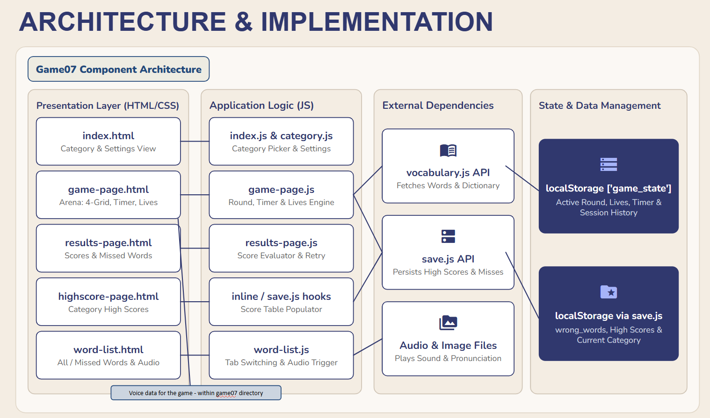
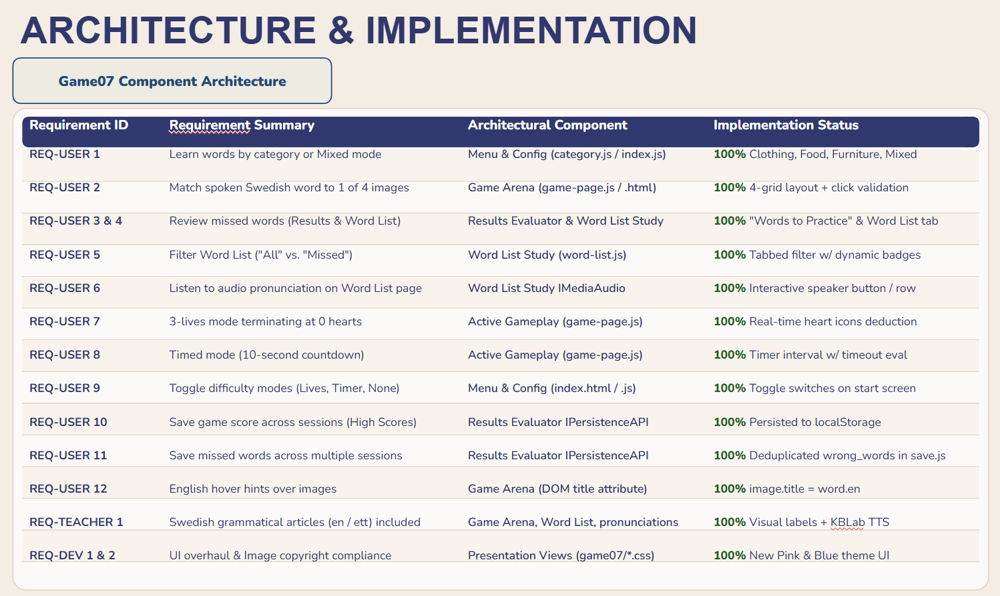

# Say What? — Game 07

A Swedish vocabulary game. Listen to a word and select the matching picture.

Includes vocabulary categories, optional timer and lives, a word list, and high scores.
## Run locally

From the repository root:  

```sh

python3 -m http.server 8000

```


Open http://localhost:8000/game07/index.html.

Built with HTML, CSS, and JavaScript for the Software Engineering and Project Management course, 2025.

## Audio credits

  
Existing files in `audio/` include reviewed pronunciations and replacement recordings.

`generate_audio.py` preserves all existing audio files and generates only missing ones.

It still rebuilds `pronunciations.js` from the vocabulary CSV. To replace a recording,

copy the approved WAV file into `audio/` using its existing filename.

Keep a backup and commit approved recordings to Git so they can be recovered.

  

Speech generated using KBLab’s Swedish Piper model.

Source: [Faton Rekathati, “Swedish Speech Synthesis” (2023)](https://kb-labb.github.io/posts/2023-05-24-swedish-text-to-speech/).

The training dataset is licensed under CC0, according to the [model card](https://huggingface.co/rhasspy/piper-voices/blob/main/sv/sv_SE/nst/medium/MODEL_CARD).


## Recommendations for next developers
**Articles:** Make sure all audios and displayed answers have en/ett articles (currently missing for: “hatt”)

**Retry mode:** Make “Try missed words again” stop when all missed rounds are completed, preventing further rounds with broken images

**Word List:** Display en/ett articles, provide missed-word-filterung, and show audio buttons 

**High Scores:** Ensure the completed game’s score appears on the High Scores Page Automatic 

**Next Question:** When answering correctly, the game automatically goes to the next question


## Software Architecture



## User Stories

