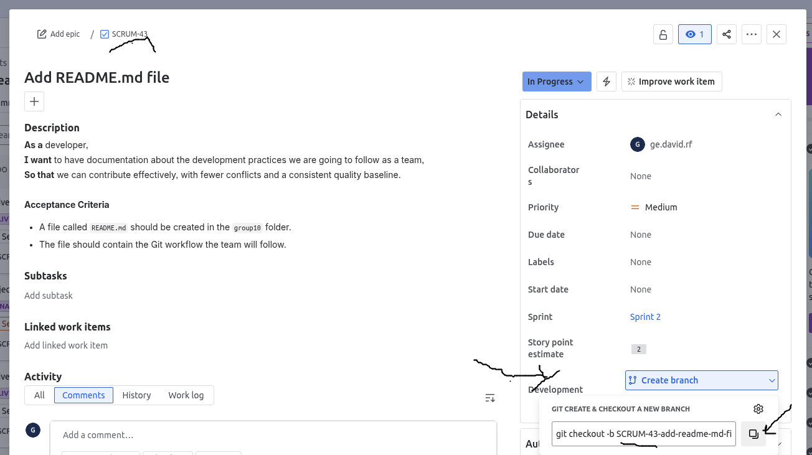

# Game 10 – Ät och lär

## User stories

All user stories from our requirements elicitation (D2, version 2026-09-23).

Status: Done, Partly done, or Open.

### Learner

| ID | User story | Status |
|---|---|---|
| REQ-LEARNER-1 | A learner wants the game to use images from the book used in class so that they can connect the vocabulary in the game with what they are learning in the classroom. | Done |
| REQ-LEARNER-2 | A learner wants an easy-to-understand interface so that they can focus on learning the vocabulary rather than on understanding how to use the game. | Done |
| REQ-LEARNER-3 | A learner wants to know whether their answer was correct or incorrect so that they can understand how they are doing. | Done |
| REQ-LEARNER-4 | A learner wants to see the correct picture–word pair after an incorrect true-or-false answer so that they can learn the correct vocabulary from their mistake. | Done |
| REQ-LEARNER-5 | A learner wants to practise each word before words are repeated so that they can practise all of the vocabulary in the exercise. | Done |
| REQ-LEARNER-6 | A learner wants to access any practice level without completing previous levels so that they can choose a level that suits their learning needs. | Done |
| REQ-LEARNER-7 | A learner wants to review the vocabulary they answered incorrectly after completing an exercise so that they can focus further practice on words they found difficult. | Partly done (levels 1 and 3, not level 2) |
| REQ-LEARNER-8 | A learner wants the in-game buttons and instructions to follow the language selected on the website so that they can understand how to use the game in either English or Swedish. | Done |
| REQ-LEARNER-9 | A learner wants to be able to reset their Game 10 progress so that they can start the game again without previous scores or progress carrying over. | Done |
| REQ-LEARNER-10 | A learner wants to see their progress during an exercise so that they know how much of the activity they have completed and how much is left. | Done |
| REQ-LEARNER-11 | A learner wants their score to accurately reflect their performance in the current exercise so that they can understand how well they did. | Done |
| REQ-LEARNER-12 | A learner wants the images in the game to be fully and clearly visible so that they can easily recognise the objects connected to the vocabulary. | Done |
| REQ-LEARNER-13 | A learner wants to be informed if they try to submit an incomplete exercise so that they do not accidentally finish it without answering all of the questions. | Done |
| REQ-LEARNER-14 | A learner wants to hear how vocabulary words are pronounced so that they can practise words that they find difficult to pronounce. | Done |
| REQ-LEARNER-15 | A learner wants important information in the game to be understandable without relying only on colour so that they can use the game despite colour-vision difficulties. | Done |
| REQ-LEARNER-16 | A learner wants their completed progress to be remembered when they leave and return to the game so that they can continue learning without losing what they have already completed. | Done |

### Teacher

| ID | User story | Status |
|---|---|---|
| REQ-TEACHER-1 | A teacher wants the game to practise vocabulary used in class so that it can support their students' classroom learning. | Done |
| REQ-TEACHER-2 | A teacher wants learners to be able to choose different practice levels so that students with different abilities can practise at an appropriate level. | Done |
| REQ-TEACHER-3 | A teacher wants vocabulary practice to include engaging game activities so that students remain motivated to continue practising. | Done |

### Development team

| ID | User story | Status |
|---|---|---|
| REQ-DEV-1 | A developer wants copyright information for the images used in the game to be displayed so that the creators are credited and the legal requirements for using the images are fulfilled. | Open |

# Development Workflow

All changes to the source code must have a ticket created in Jira. For example:

> **User Story:**  
> As a developer, 
> I want to have documentation about the development practices we are going to follow as a team, 
> so that we can contribute effectively with fewer conflicts and a consistent quality baseline.
>
> **Acceptance Criteria:**
> - A file called README.md should be created in the game10 folder
> - The file should contain the Git workflow the team will follow

## Git Workflow

1. **Clone the repository:**
   
   ```bash
   git clone git@github.com:uu-semp/swedish-learning-app-2025.git
   ```
   This command clones the repository to your machine.

2. **Get the latest changes:**

   ```bash
   git pull
   ```
   Make sure you have the latest version of the code locally.

3. **Create a feature branch:**

 


   To get the branch name:
   - Go to Jira and open the ticket you are going to work on.
   - Click **Details** > **Development** > **Create branch**.
   - Jira will suggest a name based on the ticket title.
   - You can modify it, but add `team10/` at the beginning (the historical branch
     prefix; it is unrelated to this folder's name).
   - *Note: I will check with Allison to modify the prefix so that `team10` is added automatically instead of `SCRUM-`.*

   ```bash
   git checkout -b team10/SCRUM-43-add-readme-md-file
   ```
  
4. **Commit your changes:**

   ```bash
   # Add the file(s) you want to commit.
   git add file_name.js
   ```

   ```bash
   git commit -m "Add README.md with development workflow"
   ```

5. **Push to GitHub:**

   ```bash
   git push
   ```

6. **Create a Pull Request** on GitHub.

7. **Approval required:** Follow the current Git rule. At least one approval from any team member is required before merging changes to the main branch.


# Dev Tools

The aim of this folder is to provide practical tools and information to speed up the development process.

## GenAI

This project uses the following AI generative tools:

* GitHub Copilot


## Update Word List

TL;DR: The procedure was deleted on:

```bash
git log --diff-filter=D -- assets/gen-vocab.py
commit 26774254a7ace94d34306daf68a8c2cde0ba830d
Author: Fridtjof Stoldt <xFrednet@gmail.com>
Date:   Fri Oct 10 16:21:17 2025 +0200

    Data: Update docs for async access

$ git log --stat 26774254a7ace94d34306daf68a8c2cde0ba830d
commit 26774254a7ace94d34306daf68a8c2cde0ba830d
Author: Fridtjof Stoldt <xFrednet@gmail.com>
Date:   Fri Oct 10 16:21:17 2025 +0200

    Data: Update docs for async access

 .github/workflows/check-generated-files.yml | 27 ------------------------
 assets/README.md                            | 62 ++++++++++++++++++++++++++++++++----------------------
 assets/gen-vocab.py                         | 77 -------------------------------------------------------------------
 3 files changed, 37 insertions(+), 129 deletions(-)

commit d2613f69fba6b1a02764d1d7737cec0f26259c38
Author: Fridtjof Stoldt <xFrednet@gmail.com>
Date:   Fri Oct 10 15:59:41 2025 +0200

    Data: Add async data fetching and wrap it in the old API

 scripts/{alternative_backend => }/database_config.js  |   0
 scripts/{alternative_backend => }/database_type.js    |   3 +-
 scripts/vocabulary.js                                 | 175 ++++++--------------------------------------------------
 scripts/{alternative_backend => }/vocabulary_await.js | 121 ++++++++++++++++++++++++++-------------
 4 files changed, 98 insertions(+), 201 deletions(-)
```


Note: The following commands work in Linux but not on Mac or Windows.

```bash
# Disable external fetching in the vocabulary script
sed -i 's/const FETCH_EXTERNAL = true;/const FETCH_EXTERNAL = false;/' scripts/vocabulary.js

# Download the latest word list from the Google Sheets document as a CSV file
# Original Sheet shows this error: 
#    Error: Duplicate ID found -> #ERROR!
#curl -L "https://docs.google.com/spreadsheets/d/1de16iRzmgSqWvTTxiNvQYM79sWJBwFJN0Up3Y0allDg/export?format=csv&gid=0" -o words.csv

# Curate DB for food
curl -L "https://docs.google.com/spreadsheets/d/16rDLsfAVBxNiDR9hT17w0rKA5gWWDrF2Z93-XJTH2bc/export?format=csv&gid=0" -o words.csv


# Verify that the FETCH_EXTERNAL constant has been updated in the vocabulary script
grep "const FETCH_EXTERNAL" scripts/vocabulary.js

# List the details of the downloaded CSV file to confirm its presence
ls -ltra words.csv

# Generate the vocabulary JSON file using the Python script
python3 ./assets/gen-vocab.py

# Count the number of lines in the generated vocabulary JSON file to verify its content
wc -l assets/vocabulary.json
```


## Run Static Website Locally


```bash
python3 -m http.server 8000
```

### Unit tests

http://127.0.0.1:8000/game10/index.html
http://127.0.0.1:8000/game10/learning_mode/learning_mode.html


## Run Static Website in GitHub Pages

Fork the repo, enable GitHub pages.
